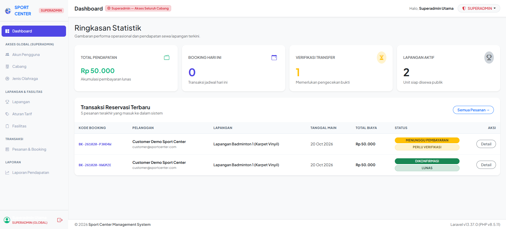

<h2 id="tentang">📖 Tentang</h2>

Sistem informasi manajemen dan penyewaan lapangan olahraga berbasis web multi-cabang (*multi-branch*) yang dibangun menggunakan **Laravel 11**, **Tailwind CSS**, dan **Alpine.js**. Dirancang untuk kinerja tinggi, keamanan transaksi *concurrency* (*zero double booking*), serta penerapan tarif dinamis secara fleksibel.

## 📌 Daftar Isi

* [Tentang Proyek](#-tentang-proyek)
* [Tampilan Antarmuka](#-tampilan-antarmuka)
* [Fitur Utama](#-fitur-utama)
* [Persyaratan Sistem](#-persyaratan-sistem)
* [Panduan Instalasi & Setup](#-panduan-instalasi--setup)
* [Struktur Folder](#-struktur-folder)
* [Arsitektur Sistem](#-arsitektur-sistem)
* [Hak Akses Pengguna (RBAC)](#-hak-akses-pengguna-rbac)
* [Pedoman Pengembangan](#-pedoman-pengembangan)
* [Lisensi](#-lisensi)

## 📸 Tentang Proyek

**Sport Center Information System** adalah solusi lengkap untuk pengelolaan operasional tempat olahraga multi-cabang. Aplikasi ini mengotomatiskan proses reservasi lapangan per jam, menyediakan matriks ketersediaan jadwal *real-time*, menyesuaikan tarif secara otomatis berdasarkan jam sibuk (*peak hours*) & akhir pekan, serta mencegah pemesanan ganda melalui penguncian transaksi database (*pessimistic locking*).

## 🖥️ Tampilan Antarmuka

### Dashboard Utama Superadmin
Tampilan dashboard untuk **Superadmin** memberikan gambaran umum mengenai performa operasional, statistik transaksi, serta daftar reservasi terbaru di seluruh cabang secara *real-time*.

#### Screenshot Dashboard Utama Superadmin

<p align="center">
  
</p>

#### Ringkasan Statistik & Fitur Dashboard:
* **Total Pendapatan:** Akumulasi pembayaran dari seluruh transaksi booking yang telah lunas.
* **Booking Hari Ini:** Jumlah reservasi jadwal yang aktif dan terdaftar pada hari ini.
* **Verifikasi Transfer:** Indikator transaksi pembayaran manual yang memerlukan verifikasi bukti transfer dari admin/operator.
* **Lapangan Aktif:** Jumlah unit lapangan yang siap dan aktif disewa oleh publik.
* **Tabel Transaksi Reservasi Terbaru:** Pemantauan langsung 5 transaksi terakhir lengkap dengan status pembayaran (cth: *Menunggu Pembayaran*, *Perlu Verifikasi*, *Dikonfirmasi*, *Lunas*), rincian pelanggan, tanggal main, serta akses langsung ke detail pesanan.

## ✨ Fitur Utama

### ⚽ Fitur Pelanggan (Customer)

* **Katalog Interaktif:** Filter lapangan berdasarkan cabang, jenis olahraga, dan fasilitas yang tersedia.
* **Matriks Jadwal Real-Time:** Tampilan *grid* slot jam harian beserta rincian kalkulasi harga instan.
* **Dynamic Pricing Engine:** Perhitungan tarif otomatis berdasarkan jam biasa vs. jam sibuk (*peak hours*) dan hari libur/akhir pekan.
* **Proteksi Double Booking:** Menerapkan transaksi `lockForUpdate` untuk menjamin slot jam tidak dapat dipesan ganda.
* **Dual Metode Pembayaran:** Integrasi *Payment Gateway* otomatis (Midtrans via QRIS/VA) dan pengunggahan bukti transfer bank manual.
* **E-Ticket & QR Code:** Penerbitan tiket digital instan berisi kode QR setelah pembayaran terverifikasi.

### 🏢 Fitur Operator & Admin

* **Terminal Check-In Operator:** Pemindai QR Code di lokasi untuk verifikasi tiket masuk dan pembuatan pesanan langsung (kasir/walk-in).
* **Manajemen Cabang (Admin Cabang):** Pengelolaan master data lapangan, aturan tarif jam sibuk, dan verifikasi transfer manual.
* **Dashboard Keuangan (Superadmin):** Laporan pendapatan konsolidasi antar-cabang, statistik transaksi, dan ekspor laporan PDF.
* **Sistem Pembatalan Otomatis:** *Job Scheduler* yang membatalkan pesanan *pending* secara otomatis jika melewati batas waktu bayar (15 menit).

## 🛠️ Persyaratan Sistem

* **PHP:** v8.3 atau lebih baru
* **Composer:** v2.x
* **Node.js & NPM:** v18.x atau lebih baru
* **Database Server:** MySQL 8.0+ atau MariaDB 10.6+ (InnoDB Engine)
* **Web Server (Lokal):** Apache / Nginx / XAMPP / Laragon / PHP Built-in Server

## 🚀 Panduan Instalasi & Setup

### 1. Clone Repository & Install Dependensi

```bash
# Clone repository
git clone https://github.com/username/sport-center.git
cd sport-center

# Install dependensi PHP
composer install


### 2. Konfigurasi Environment (`.env`)

```bash
# Salin file konfigurasi environment
cp .env.example .env

# Generate Application Key
php artisan key:generate
```

Buka file `.env` dan sesuaikan konfigurasi database Anda:

```env
DB_CONNECTION=mysql
DB_HOST=127.0.0.1
DB_PORT=3306
DB_DATABASE=sport_center_db
DB_USERNAME=root
DB_PASSWORD=
```

### 3. Migration & Seeding Database

Jalankan perintah berikut untuk membuat struktur tabel beserta data bawaan (*roles*, *users*, dan master data awal):

```bash
php artisan migrate --seed
```

### 4. Storage Linking

Hubungkan direktori penyimpanan berkas agar bukti pembayaran dan gambar dapat diakses publik:

```bash
php artisan storage:link
```

### 5. Menjalankan Aplikasi

```bash
# Jalankan Server Laravel (di terminal terpisah)
php artisan serve
```

Akses aplikasi di browser melalui URL: `http://localhost:8000`

> 💡 **Catatan untuk Task Queue:** Untuk mengaktifkan fitur pembatalan otomatis pesanan yang kedaluwarsa (15 menit), jalankan perintah queue worker:
> ```bash
> php artisan queue:work
> ```

## 📂 Struktur Folder

Berikut adalah gambaran struktur folder utama proyek **Sport Center**:

```
sport-center/
├── 📁 app/
│   ├── 📁 Http/
│   │   ├── 📁 Controllers/
│   │   │   ├── 📁 Admin/            # Controller Dashboard & Manajemen Admin
│   │   │   ├── 📁 Auth/             # Controller Autentikasi
│   │   │   ├── 📁 Customer/         # Controller Katalog, Booking & Pembayaran
│   │   │   └── 📁 Operator/         # Controller Check-In & Walk-In Kasir
│   │   ├── 📁 Middleware/          # Guard & Middleware Hak Akses Role
│   │   └── 📁 Requests/            # Custom Form Request Validasi Input
│   ├── 📁 Models/                  # Eloquent Models (User, Booking, Court, dll.)
│   ├── 📁 Policies/                # Authorization Policies (IDOR Protection)
│   ├── 📁 Providers/               # Service Providers
│   └── 📁 Services/                # Service Layer (Logika Bisnis & Pricing Engine)
├── 📁 bootstrap/                   # Inisialisasi Aplikasi Laravel
├── 📁 config/                      # File Konfigurasi Sistem
├── 📁 database/
│   ├── 📁 factories/               # Factory Data Testing
│   ├── 📁 migrations/              # Berkas Migrasi Tabel Database
│   └── 📁 seeders/                 # Seeder Master Data & User
├── 📁 public/                      # Entry Point Publik (index.php, Assets)
├── 📁 resources/
│   ├── 📁 css/                     # Tailwind CSS Custom Styling
│   ├── 📁 js/                      # Script JS / Alpine.js
│   └── 📁 views/                   # Template Blade Layouts & Components
│       ├── 📁 admin/               # Tampilan Admin & Kelola Cabang
│       ├── 📁 auth/                # Tampilan Login & Register
│       ├── 📁 customer/            # Tampilan Dashboard & History Pemesanan
│       ├── 📁 layouts/             # Master Layouts (Admin, Customer, Public)
│       ├── 📁 operator/            # Tampilan Kasir & Scan QR Check-in
│       └── 📁 public/              # Tampilan Katalog Lapangan & Homepage
├── 📁 routes/
│   ├── 🐘 console.php               # Artisan Command Custom
│   └── 🐘 web.php                   # Routing Aplikasi Web
├── 📁 storage/                     # Penyimpanan Log, Cache, & Upload Media
├── 📝 AGENTS.md                    # Aturan Pengembangan AI & Developer
├── 📝 ARCHITECTURE.md              # Spesifikasi Arsitektur Sistem
├── 📝 DATABASE.md                  # Dokumentasi Schema & ERD
├── 📝 FEATURE.md                   # Roadmap & Matrix Fitur
├── 📝 PROJECT.md                   # Ringkasan Proyek & Aktor Sistem
├── 📝 USER_FLOWS.md                # Alur Transaksi & Sequence Diagram
├── ⚙️ composer.json                # Dependensi Backend PHP
├── ⚙️ package.json                 # Dependensi Frontend Node.js
└── 📄 vite.config.js               # Konfigurasi Asset Bundler Vite
```

## 🏗️ Arsitektur Sistem

Aplikasi ini menggunakan pola **Service-Oriented Layered MVC Pattern** (*Thin Controller, Fat Service*) untuk memisahkan logika bisnis dengan penanganan HTTP request.

```
[ HTTP Request ] ➔ [ Routes ] ➔ [ Form Request Validation ] ➔ [ Controller ]
                                                                     │
                                                                     ▼
                                                             [ Service Layer ]
                                                            (app/Services/*)
                                                                     │
[ HTTP Response / Blade View ] ◄─────────────────────────── [ Eloquent Model ]
```

## 👥 Hak Akses Pengguna (RBAC)

| Peran (Role) | Cakupan Akses | Deskripsi Hak Akses |
| :--- | :--- | :--- |
| **Guest** | Publik | Melihat katalog lapangan, cabang, fasilitas, serta jadwal ketersediaan. |
| **Customer** | Otentikasi | Melakukan reservasi, unggah bukti bayar, klaim tiket QR, dan kelola profil. |
| **Operator** | Cabang Spesifik | Verifikasi *check-in* tiket QR Code dan melayani pesanan *walk-in* tunai. |
| **Admin Cabang** | Cabang Spesifik | Mengatur tarif *peak hours*, kelola lapangan cabang, dan verifikasi transfer. |
| **Superadmin** | Global | Akses penuh seluruh cabang, manajemen staf/staf cabang, dan laporan analitik. |

## 📏 Pedoman Pengembangan

1. **No Inline Logic in Controllers:** Seluruh logika bisnis (kalkulasi harga, pengecekan slot, dan pembuatan booking) wajib berada di folder `app/Services/`.
2. **Pessimistic Locking:** Transaksi reservasi wajib menggunakan `DB::transaction()` dan `lockForUpdate()` untuk menjamin keamanan dari *race condition*.
3. **Form Request Validation:** Seluruh validasi form harus ditempatkan pada class *Custom Form Request* di `app/Http/Requests/`.
4. **Environment Safety:** Dilarang keras melakukan *hardcode* pada kredensial sensitif; selalu gunakan variabel di file `.env`.

## 📄 Lisensi

Proyek ini berada di bawah lisensi [MIT License](https://opensource.org/licenses/MIT).